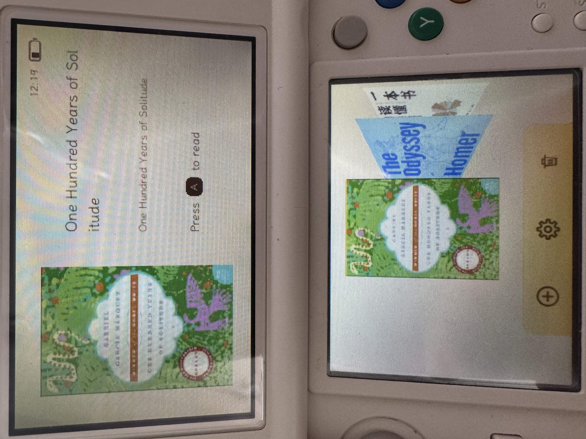
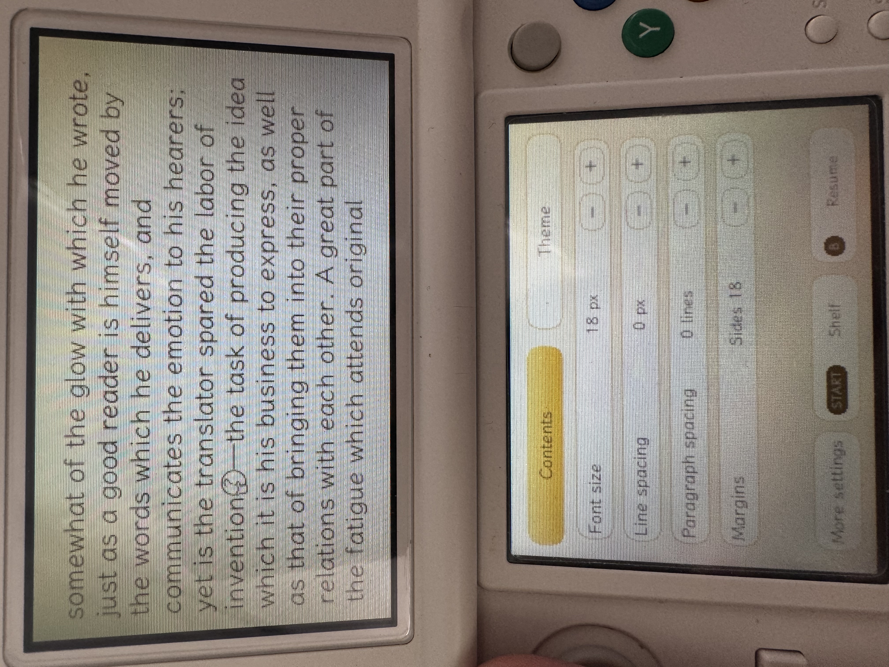
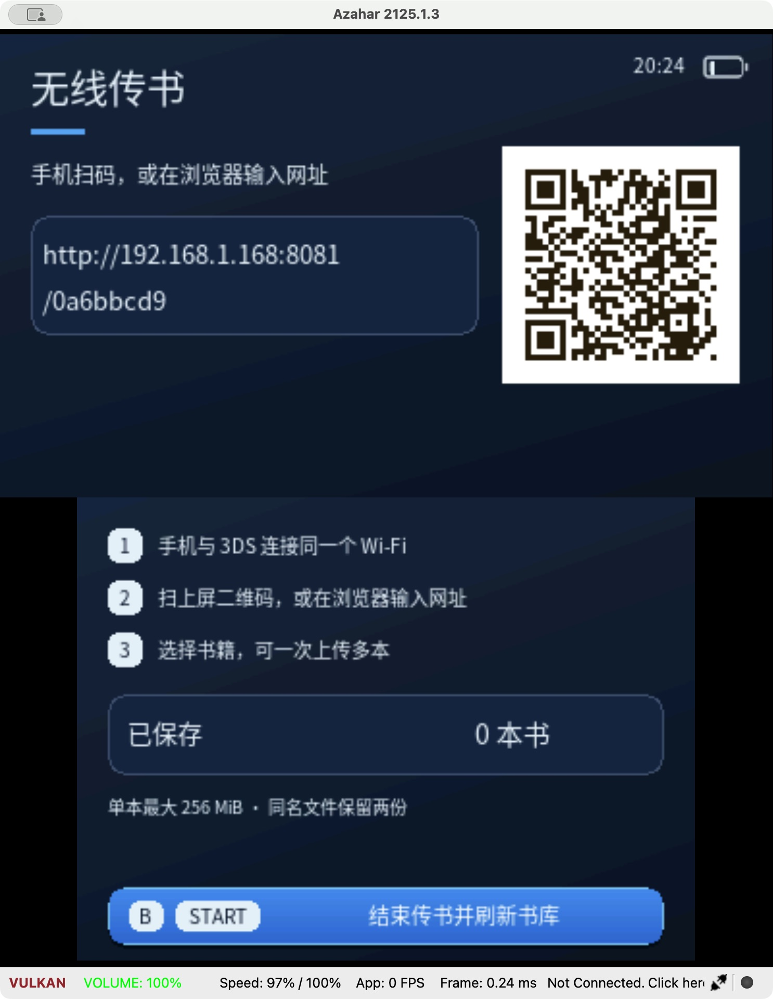
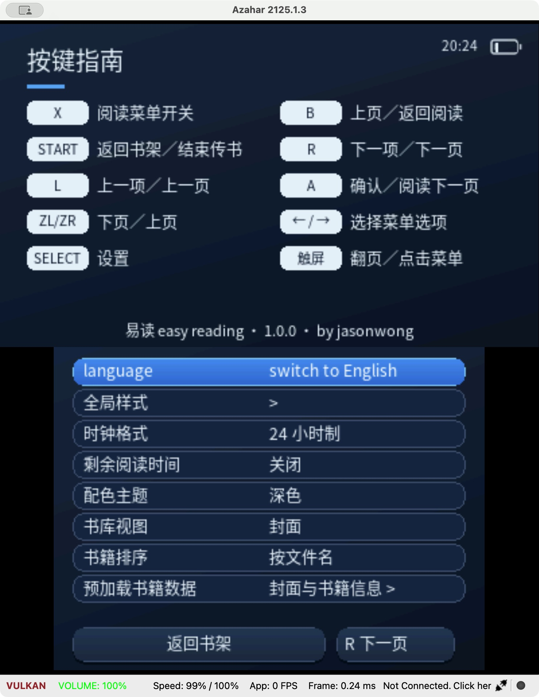

# Easy Reading / 易读

A landscape ebook reader for Nintendo 3DS, customized by **jasonwong** and based on [3dslibris](https://github.com/RigleGit/3dslibris).

English and Simplified Chinese interfaces, a cover-based bookshelf, touch and button controls, and local Wi-Fi book uploads.

[User guide](docs/USER_GUIDE.md) · [中文指南](docs/USER_GUIDE.zh-CN.md) · [Build instructions](BUILD_CUSTOM_EDITION.md) · [Third-party notices](THIRD_PARTY_NOTICES.md)

## About this edition

Easy Reading 1.0.0 turns a Nintendo 3DS into a landscape ebook reader with a visual library and quick reading controls. It is built on **3dslibris**, with a new Easy Reading identity and interface by **jasonwong**. Use the physical controls or touch screen to browse covers, read, adjust supported layout settings and transfer books over local Wi-Fi without removing the SD card.

See the [full application introduction](docs/APP_OVERVIEW.md).

## In action

**English — real 3DS hardware**

 

**中文演示 — 模拟器、深色主题 / Chinese — Dark theme in Azahar**

 

[Full gallery: HOME banner, settings, reading tools and wireless transfer](docs/SCREENSHOTS.md)

## Features

- Landscape reading across both screens.
- Cover carousel with an enlarged preview on the upper screen.
- Light gold and dark blue interface themes.
- English / Simplified Chinese language switching.
- Reading tools for contents, theme, font size, line spacing, paragraph spacing and margins, where supported by the book format.
- Local wireless uploads: scan a QR code or enter the displayed URL on a phone or computer. The upload page follows the language selected in the app.
- Bookshelf delete mode with a confirmation prompt.
- Custom HOME Menu icon, latest animated bilingual banner and audio in the CIA build.

Supported file extensions: **EPUB, TXT, PDF, CBZ, MOBI, FB2, Markdown, RTF, ODT and XPS**. Compatibility depends on the document; fixed-layout files do not have the same text styling options as EPUB or TXT.

## Install

Use a homebrew-enabled 3DS-family system.

| File | Purpose |
| --- | --- |
| `easy-reading-1.0.0.cia` | Install with FBI or your existing CIA installer. |
| `easy-reading-1.0.0.3dsx` | Launch through Homebrew Launcher. |
| `easy-reading-1.0.0-source.tar.gz` | Corresponding source, build scripts, resources and third-party code. |
| `SHA256SUMS.txt` | Release file checksums. |

For Homebrew Launcher, rename the 3DSX to `easy reading.3dsx` and place it at `/3ds/easy reading/easy reading.3dsx` on the SD card. Runtime resources are embedded in the supplied builds.

Put books in `/3ds/easy reading/book/`, or use the **Import** icon on the bookshelf. Older edition data in `/3ds/3dslibris/` is migrated automatically; back up your SD data before upgrading. Same-name migration conflicts are preserved as `.legacy` backups.

## SD card directories

```text
/3ds/easy reading/
├── easy reading.3dsx   # Homebrew Launcher only
├── book/              # Put your books here
├── easy reading.xml   # Settings and stored book state
├── cache/             # Generated cover / metadata / document caches
├── font/              # Optional SD fonts
└── resources/         # Optional SD resources
```

The space in `easy reading` is intentional. The CIA is installed through your installer; it does not have to live in the book directory. Runtime resources are embedded. Older edition data is migrated automatically. See [full paths and migration details](docs/SD_CARD_PATHS.md).

## Quick controls

| Screen | Controls |
| --- | --- |
| Bookshelf | Circle Pad / D-pad left-right or L/R to select; A to open. Touch a cover to select, then tap it again to open. |
| Bookshelf dock | Import, Settings, Delete. Touch an icon, or use down then left/right and A. |
| Reading, tools closed | A / R / ZL: next page. B / L / ZR: previous page. X: reading tools. |
| Reading touch | Left: previous page; right: next page; bottom-right tools icon: tools. The middle of the page does not open tools. |
| Reading tools | Circle Pad / D-pad to select, A to confirm, B or X to resume reading, START to return to the shelf. |
| Settings | Circle Pad / D-pad to select; A to activate; L/R to change settings pages. |
| Wireless transfer | B, START or the bottom exit button to finish and refresh the shelf. |

In delete mode, B exits delete mode. Deleting a book removes its SD-card file after confirmation.

## Release status

**1.0.0 is the first stable release.** The release, in-app and CIA package versions are 1.0.0. The maintainer reports successful testing on a physical Japanese New Nintendo 3DS. The supplied hardware photographs show the 1.0.0 interface and HOME banner; the banner payload and original audio also pass static integrity checks.

Large or complex documents may take time to open. During a blocking loading stage, wait until loading finishes before returning to the shelf. Animation speed and document compatibility can vary by hardware and file.

## Credits and licenses

- [RigleGit / 3dslibris](https://github.com/RigleGit/3dslibris): upstream reader.
- [Epic0522 / ClouDS Music FA](https://github.com/Epic0522/ClouDS-Music-FA/tree/clouds-music-fa): UI and animation references and MIT components.
- [ZIXT233 / 3DS-FileBrowser](https://github.com/ZIXT233/3DS-FileBrowser): wireless transfer inspiration and bundled QR / HTTP parsing components.
- Easy Reading design and customization: **jasonwong**.

[Detailed project sources, reused components and credits](docs/PROJECT_SOURCES.md).

Preserve the original copyright notices. The inherited reader is GPL-2.0-or-later; this build also includes AGPL-3.0-or-later MuPDF and separately licensed components and fonts. See [LICENSE](LICENSE), [LICENSES](LICENSES) and [THIRD_PARTY_NOTICES.md](THIRD_PARTY_NOTICES.md). This release includes the corresponding source archive.

---

**中文简介：** 易读是一款基于 3dslibris 修改的任天堂 3DS 横屏阅读器，支持中英文界面、封面书架、阅读样式设置和扫码无线传书。安装方法与完整按键说明请见[中文指南](docs/USER_GUIDE.zh-CN.md)。1.0.0 为正式版；应用已实机验证，已附实机与中文深色模拟器展示。
