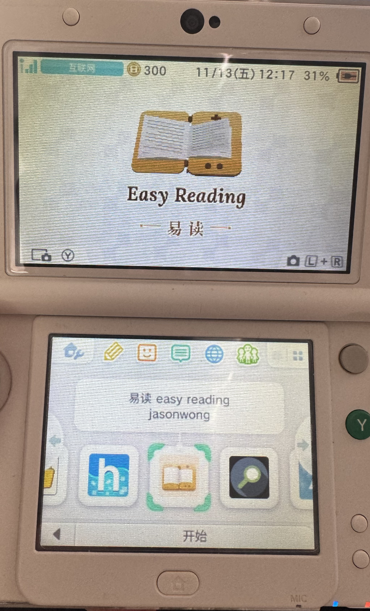
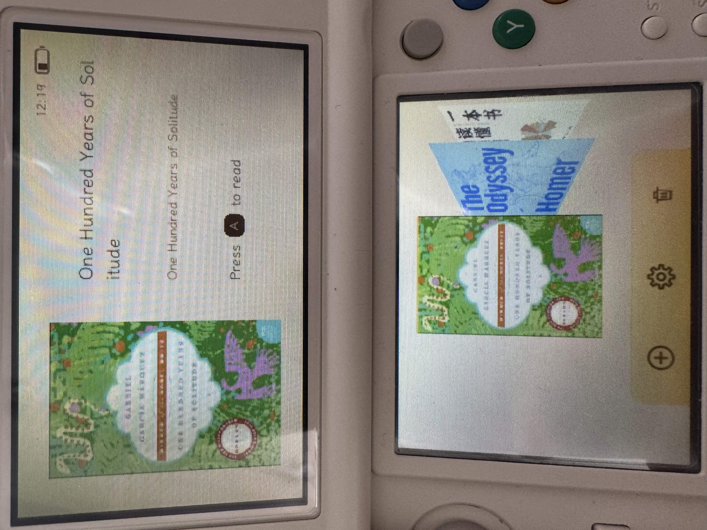
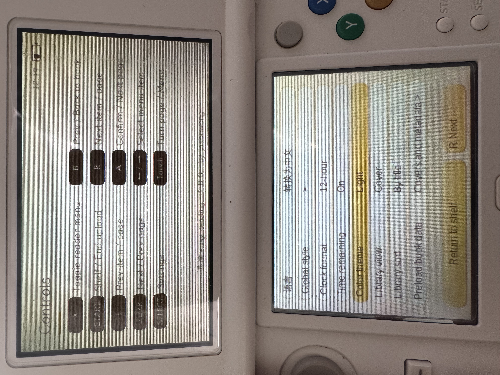
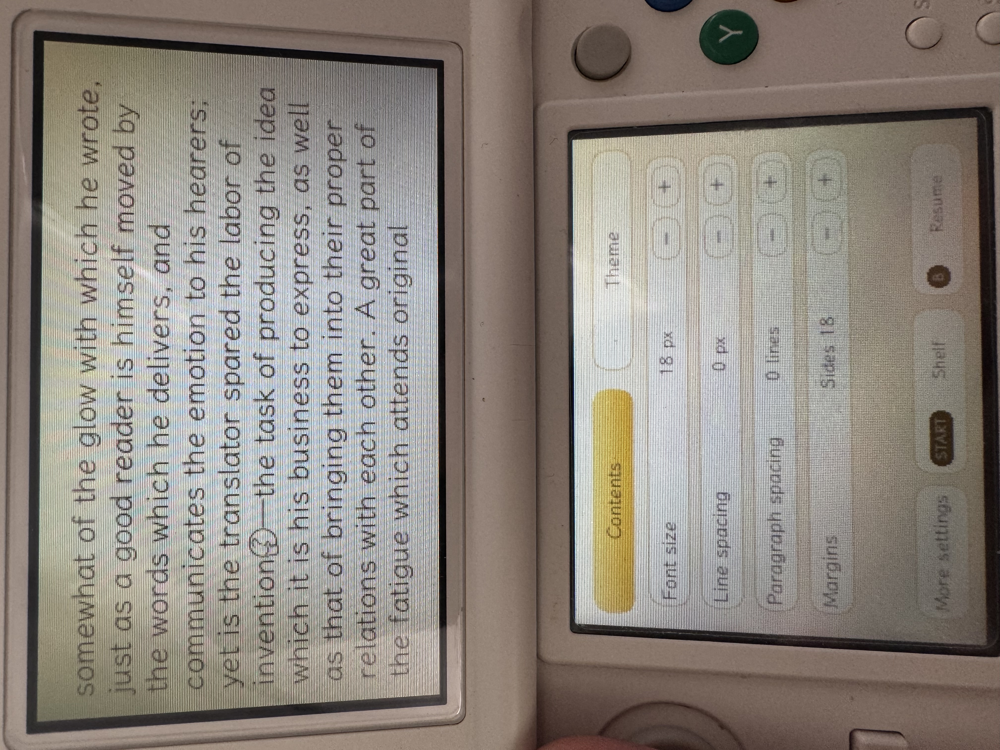
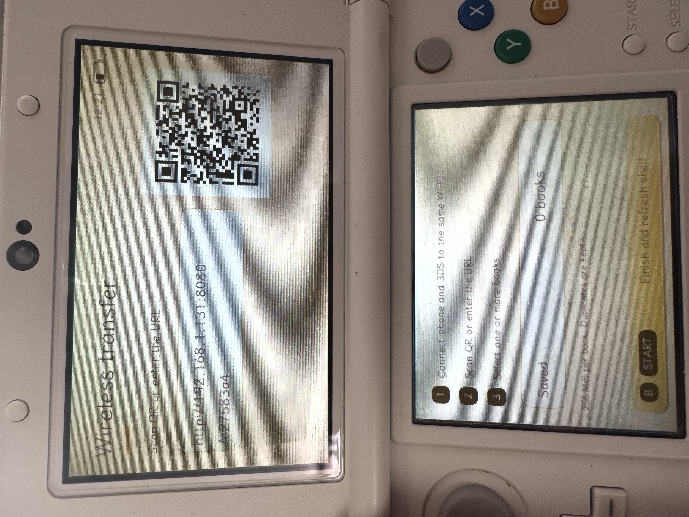
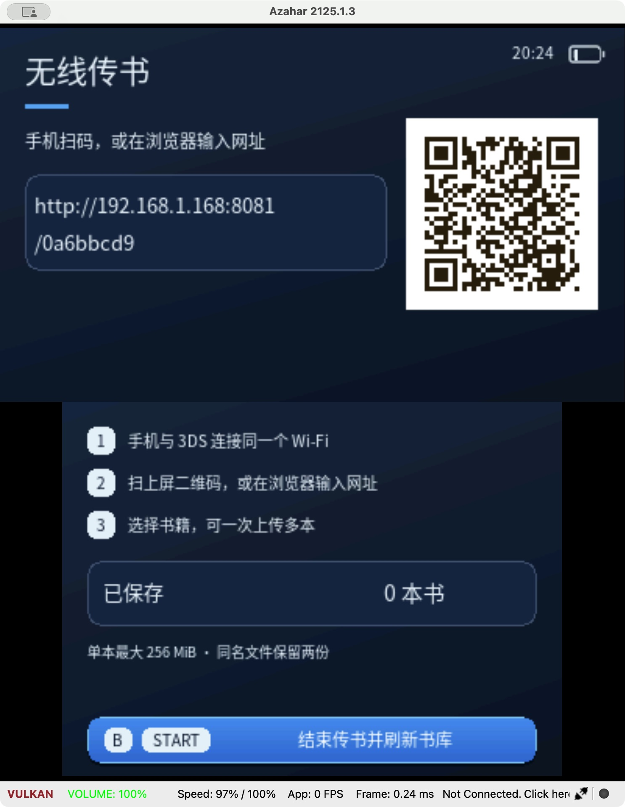
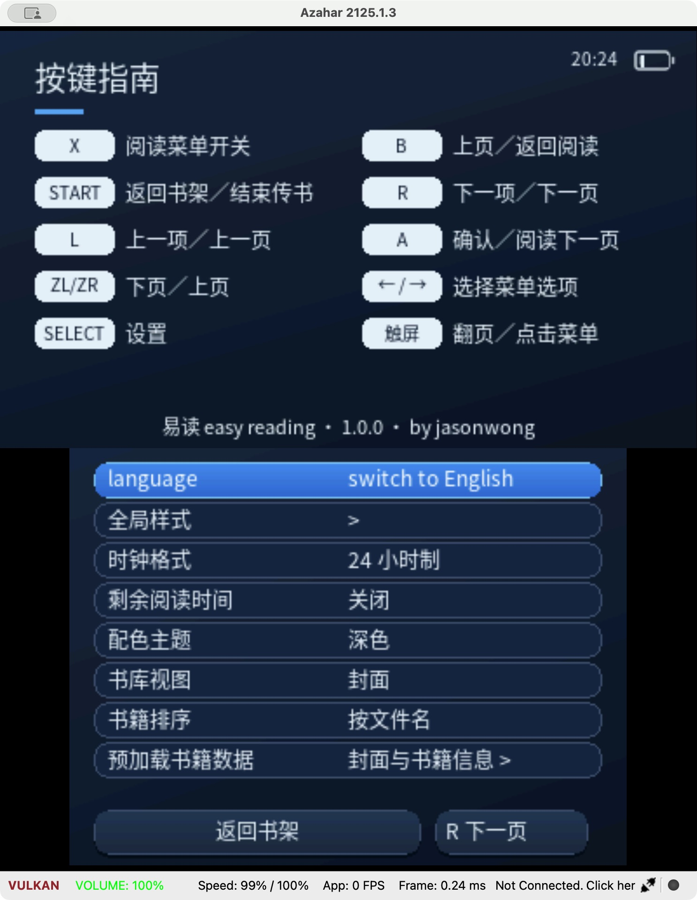
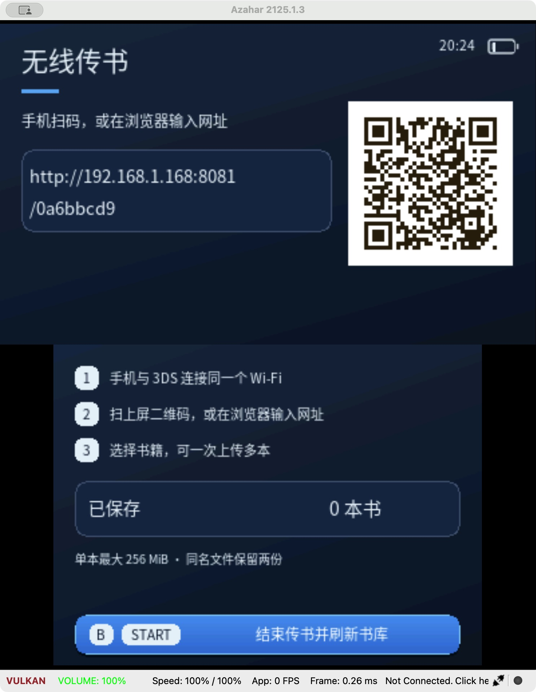
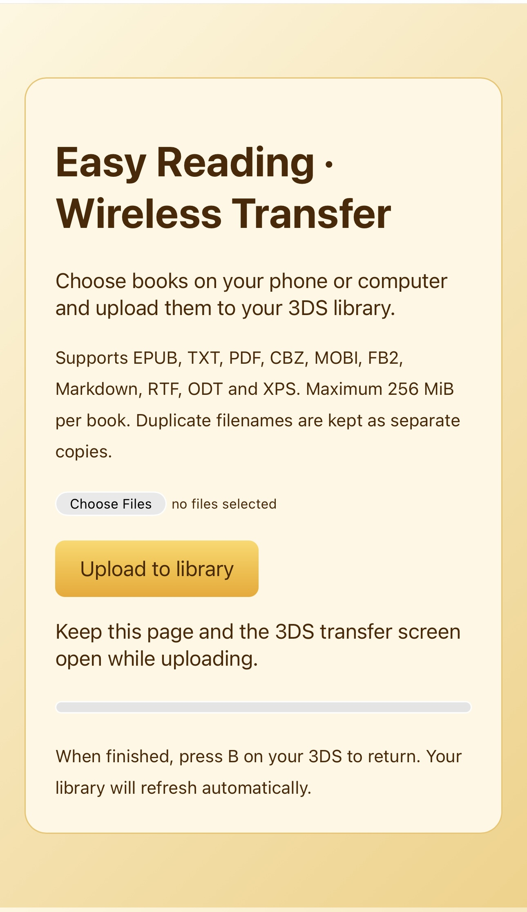

# Screenshots / 演示画面

English demonstrations use the maintainer's physical Japanese New Nintendo 3DS. Chinese demonstrations use the 1.0.0 3DSX in Azahar with the Dark theme. These photographs and captures are not interchangeable representations of hardware performance. The bilingual HOME banner is shown on real hardware. Transfer addresses / QR codes in pictures are examples from a session; use the address displayed by your own app.

## English — Physical 3DS / 英文实机

### HOME Menu icon and bilingual banner / HOME 图标与中英横幅

### English bookshelf / 英文书架

### English settings and controls; version 1.0.0 / 英文设置与按键指南

### Reading tools on hardware / 实机阅读工具

### Wireless transfer on hardware / 实机无线传书

## Chinese — Dark theme in Azahar / 中文深色模拟器

### Chinese bookshelf, Dark theme / 中文深色书架

### Chinese settings, Dark theme / 中文深色设置

### Chinese wireless transfer, Dark theme / 中文深色传书

## English browser upload / 英文网页上传

Maintainer-supplied browser screenshot, separate from the console and emulator images.

